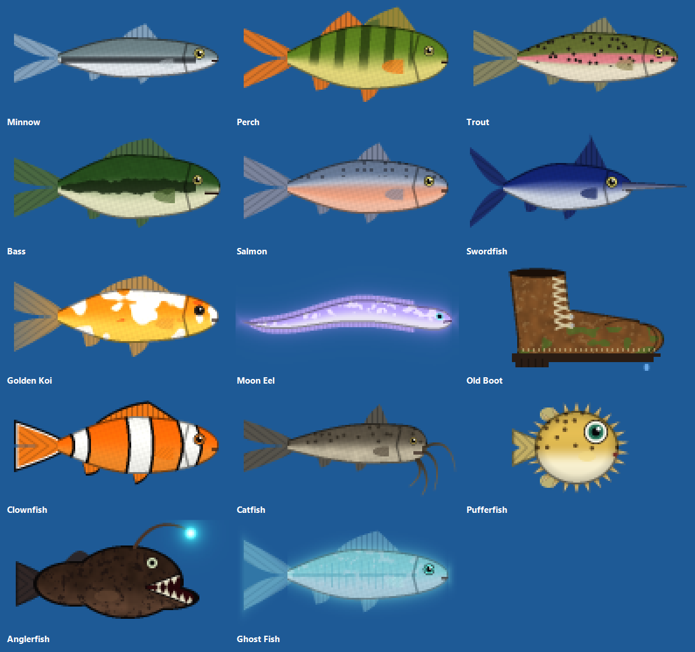

# Risk of Rain 2 fishing mod (guest client)

**Roadmap:** https://joeyvolcic.github.io/ror2-fishing/ (what's shipped, what's in testing, what's planned, and player votes)  
**Latest pre-release:** [v3.0 (untested)](https://github.com/Joeyvolcic/ror2-fishing/releases/tag/v3.0)

`FISHING.exe` is the guest half of a Risk of Rain 2 fishing game. The host runs the fishing mod itself:
casts, bites, catches, the fish you get and the tournament money are all decided in the host's game,
which announces everything through (mostly hidden) chat lines. Each guest runs `FISHING.exe`, which loads
the matching visuals and controls into **their own** running game:

- a fishing rod, line and bobber on every living player (cast, bite, reel-in, lobbed casts up to 200 m)
- the lake: a sheet of Risk of Rain 2's own water (Gilded Coast's sea material) under each stage at the host's water level
- the purple **hotspot** (10 m radius) where the best fish are, with teleporter-style sparkles
- a shared school of swimming fish (everyone sees the same fish, and the fish you see are the fish you can catch),
  plus a flopping trophy fish over whoever catches something
- **left click = fishing rod, right click = Rod Whip** (weapons removed; the whip is a Mercenary-style slash with
  Merc's own sword effect and sound, and if it hits a player in front of you it does 1 damage and snaps their line back)
- caught fish shown as fish in the item bar, with small movement perks
- the fishing tournament panel (money, fish inventory, leaderboard), with a **Download latest release** button
- the F2 request panel

Nothing is installed: everything lives in the running game, and closing the game removes it.
It does nothing on the host's own PC (the host runs its own copy of all of this).

## How to use

1. Download `FISHING.exe` from the [latest release](https://github.com/Joeyvolcic/ror2-fishing/releases/latest).
2. Start Risk of Rain 2 and join the host's lobby (or be in the run already).
3. Double-click `FISHING.exe`. It loads everything and tells you what it did; press a key to close the window.
4. Fish: **left click** to cast, left click again when it bites (typing `fish` in chat works too).
   **Right click** = Rod Whip.

Run it again each time you start the game. Running it twice is harmless; a newer FISHING.exe replaces an
older copy already loaded in your game.

## Automatic updates

Keep just the one `FISHING.exe`. Every time it starts, it checks this repository's latest release
(`latest.json`). If there is a newer version it downloads it, checks its SHA-256 hash, replaces itself
(the old copy is renamed to `FISHING.old.exe` and deleted on the next start) and restarts. If the check
fails (offline, GitHub down) it just says "Couldn't check for updates" and carries on with the version you have.
It only ever downloads from `https://github.com/Joeyvolcic/ror2-fishing/releases/download/`.

Command-line flags: `--nopause` (don't wait for a key at the end), `--no-update` (skip the update check),
`--update-only` (only check/update, then exit).

## Antivirus note

Windows Defender or other antivirus software may warn about or block `FISHING.exe`, because it loads code into
another program (the game) and downloads its own updates. That is exactly how it works; it is not a virus.
The complete source is in this repository and you can build the exe yourself (below). If it's blocked,
allow it in your antivirus, or build it from source.

## Troubleshooting

| Problem | What to check |
|---|---|
| "Risk of Rain 2 is not running" | start the game first |
| nothing shows up | the host must be running the fishing mod; log: `%TEMP%\ror2_fishing_client.log` |
| no fish | fish only appear during a run on a stage with water; log: `%TEMP%\ror2_fishfx.log` |
| rod / right click not working | `%TEMP%\ror2_noweapons.log` |
| fish look like normal items | `%TEMP%\ror2_fishitems.log` |
| F2 panel | `%TEMP%\ror2_requests.log` |

If the game runs as administrator, run `FISHING.exe` as administrator too.

## Source

| File | What it is |
|---|---|
| `src/FishingLauncher.cs` | the exe: self-updater, finds the game and loads the payloads into it (Mono `mono_runtime_invoke` via a small remote thread) |
| `src/FishingClient.cs` | rods, lines, bobbers, water, hotspot, tournament panel (runs inside the game) |
| `src/NativeWaterLook.cs` | gives the lake Risk of Rain 2's own water material |
| `src/WaterLook.cs` | generated, animated ripple/caustic water texture (fallback, and the hotspot's disc texture) |
| `src/HotspotLook.cs` | the hotspot's purple teleporter sparkles |
| `src/MercSwingLook.cs` | the Mercenary-style Rod Whip swing (Merc's slash effect, impact spark and sounds) |
| `src/FishFx.cs`, `src/FishSchool.cs`, `src/FishArt.cs` | the swimming fish, the shared school, the fish pictures |
| `src/NoWeapons.cs`, `src/NoWeaponsIconPixels.cs` | weapons removed, left click = rod, right click = Rod Whip, skill icons |
| `src/FishItems.cs` | fish in the item bar and their movement perks (the host-only part is compiled out) |
| `src/ReqPanelClient.cs` | the F2 request panel |
| `src/FishPreview.cs` | small tool that saves the fish pictures as PNGs (not part of the exe) |

### Building

Needs Windows, the .NET Framework 4 C# compiler (`csc.exe`, ships with Windows) and Risk of Rain 2 installed in the
default Steam folder (the payloads compile against the game's own Unity DLLs). Run:

```
src\build.bat
```

It produces `src\FISHING.exe`.


